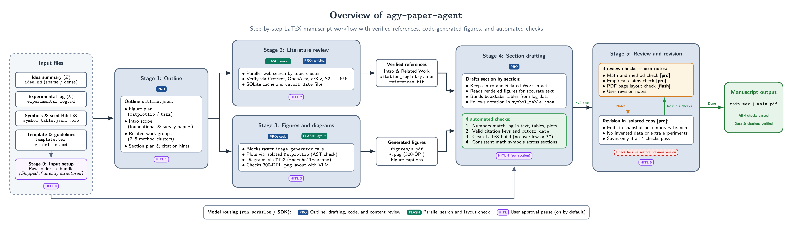

# `agy-paper-agent`

Multi-agent plugin and Python SDK package for drafting and verifying LaTeX research papers on Google Antigravity (AGY).

Built on the multi-stage structure of PaperOrchestra (arXiv:2604.05018), `agy-paper-agent` adds programmatic checks for numbers, citations, LaTeX compilation, and math notation, along with multi-source reference lookup, code-generated figures, and snapshot rollback during revision.



* Architecture diagrams (TikZ): [English PDF](assets/overview_en.pdf) | [English PNG](assets/overview_en.png) | [Vietnamese PDF](assets/overview_vi.pdf) | [Vietnamese PNG](assets/overview_vi.png)

## Key features

1. **Two execution modes (`D-01`)**:
   - **AGY plugin**: Provides `plugin.json`, `rules/AGENTS.md`, `hooks.json`, 5 `SKILL.md` guides, and `workflows/paper_pipeline.py` (`run_workflow`).
   - **Python SDK (`google.antigravity`)**: Shares the same schemas, verifiers, and skills through `GoogleAntigravityBackend` and `SDKPaperCoAuthorRunner` (`AgentBehavior.INTERACTIVE` for step-by-step use, `AgentBehavior.AUTONOMOUS` for batch runs).
2. **Optional Stage 0 input setup (`D-02`)**:
   - Works directly on a structured `paper_bundle/` (`contract/idea.md`, `contract/experimental_log.md`, `contract/symbol_table.json`), or extracts those files and `provenance_map.json` from an unstructured project folder.
3. **Step-by-step approval pauses (`D-03`)**:
   - Pauses for user review after each stage (`stage0_ingest` through `stage5_refinement`) unless `auto_approve=True` is set.
4. **Multi-source reference verification (`D-04`)**:
   - Combines `seed_references.bib` with candidate queries checked across **Crossref -> OpenAlex -> arXiv -> Semantic Scholar**, backed by a local SQLite cache and `cutoff_date` filtering.
5. **Code-generated vector figures (`D-05`)**:
   - Blocks raster `image-generator` calls via AGY `PreToolUse` hooks and SDK policy rules.
   - Runs Matplotlib scripts (`.py`) in an isolated subprocess after static AST checks, and compiles standalone TikZ files (`.tex`) with `-no-shell-escape` to `.pdf` and 300-DPI `.png`.
6. **Four automated checks (`D-06`)**:
   - `numeric_fidelity`: Checks numbers in LaTeX tables, prose claims, and Matplotlib scripts against `experimental_log.md`.
   - `citation_integrity`: Checks BibTeX syntax, registry consistency, reference usage ratio, and `cutoff_date` rules.
   - `latex_build`: Compiles with `pdflatex`/`xelatex` and `bibtex`/`biber` to catch undefined references, page-limit overflows, and `Overfull \hbox` warnings.
   - `symbol_table`: Checks math notation across sections against `contract/symbol_table.json`.
7. **Review pass with snapshot rollback (`D-07`)**:
   - Runs three targeted checks (`math_methodology`, `empirical_evidence`, `vlm_venue_layout`), applies user notes in an isolated copy, and restores the previous `manuscript/` snapshot if any automated check fails.

## Repository layout

```text
agy-paper-agent/
|-- plugin.json                     # AGY plugin manifest
|-- assets/                         # TikZ overview diagrams (EN & VI)
|-- hooks.json                      # PreToolUse & Stop hooks
|-- scripts/run_hook.py             # Cross-platform .venv hook launcher
|-- rules/AGENTS.md                 # Authoring rules loaded with the plugin
|-- skills/                         # 5 AGY skills
|   |-- paper-coauthor/SKILL.md
|   |-- paper-ingestion/SKILL.md
|   |-- paper-lit-verify/SKILL.md
|   |-- paper-vector-viz/SKILL.md
|   `-- paper-refinement/SKILL.md
|-- workflows/                      # AGY run_workflow script & schema
|   |-- paper_pipeline.py
|   `-- workflow.json
|-- schemas/                        # JSON Schemas exported from contracts.py
|-- templates/                      # Single-column & two-column LaTeX templates
|-- src/agy_paper_agent/            # Core Python package (modules <= 400 lines)
|   |-- contracts.py                # Pydantic v2 data models
|   |-- bundle.py                   # Bundle management & 4-check runner
|   |-- hooks_entry.py              # AGY hook handler
|   |-- sdk_tools.py                # SDK tool wrappers
|   |-- sdk_adapter.py              # google.antigravity runner
|   |-- ablation_harness.py         # Guardrail ablation benchmarks
|   |-- verifiers/                  # Checks 1-4 (numeric, citation, latex, symbols)
|   `-- tools/                      # Citation verifier & figure build runner
|-- examples/pilot_rc_fihgnn/       # 5-page RC-FIHGNN example bundle
`-- tests/                          # Unit, MiKTeX integration, and ablation tests
```

## Setup

Create a virtual environment in the repository root:

```powershell
Set-Location C:\Users\ADMIN\Documents\agy-paper-agent
python -m venv .venv
.\.venv\Scripts\python.exe -m pip install -e ".[dev]"
```

Optional Google Antigravity Python SDK dependency for standalone runs:

```powershell
.\.venv\Scripts\python.exe -m pip install -e ".[sdk]"
```

To register the plugin globally in AGY, add its parent directory to `~/.gemini/config/plugins.json`:

```json
{
  "entries": [
    {
      "path": "C:/Users/ADMIN/Documents",
      "include_only": ["agy-paper-agent"]
    }
  ]
}
```

## CLI commands

```powershell
# Check that JSON schemas in schemas/ match contracts.py
.\.venv\Scripts\python.exe -m agy_paper_agent --check

# Initialize and inspect a paper_bundle
.\.venv\Scripts\python.exe -m agy_paper_agent init-bundle --bundle-dir ./my_paper --template generic_article
.\.venv\Scripts\python.exe -m agy_paper_agent inspect-bundle --bundle-dir ./my_paper

# Verify candidate references across Crossref, OpenAlex, arXiv, and Semantic Scholar
.\.venv\Scripts\python.exe -m agy_paper_agent verify-citations `
  --candidates-json ./my_paper/state/raw_candidates.json `
  --output-registry ./my_paper/state/citation_registry.json `
  --output-bib ./my_paper/manuscript/references.bib `
  --seed-bib ./my_paper/contract/seed_references.bib `
  --cache-db ./my_paper/state/citations_cache.sqlite `
  --cutoff 2026-06

# Build a Matplotlib script or standalone TikZ file
.\.venv\Scripts\python.exe -m agy_paper_agent build-visual `
  --kind tikz `
  --source ./my_paper/figures/tikz/fig_arch.tex `
  --pdf ./my_paper/figures/rendered/fig_arch.pdf `
  --png ./my_paper/figures/rendered/fig_arch.png

# Run all 4 checks and export main.pdf
.\.venv\Scripts\python.exe -m agy_paper_agent verify-bundle `
  --bundle-dir ./examples/pilot_rc_fihgnn `
  --enforce-utilization `
  --output-pdf ./examples/pilot_rc_fihgnn/manuscript/main.pdf

# Run guardrail ablation tests on a bundle
.\.venv\Scripts\python.exe -m agy_paper_agent run-ablations `
  --bundle-dir ./examples/pilot_rc_fihgnn
```

## Tests and linting

```powershell
Set-Location C:\Users\ADMIN\Documents\agy-paper-agent
.\.venv\Scripts\python.exe -m agy_paper_agent --check
.\.venv\Scripts\python.exe -m pytest -v
.\.venv\Scripts\python.exe -m ruff check .
.\.venv\Scripts\python.exe -m ruff format --check .
```

## License

Apache-2.0
